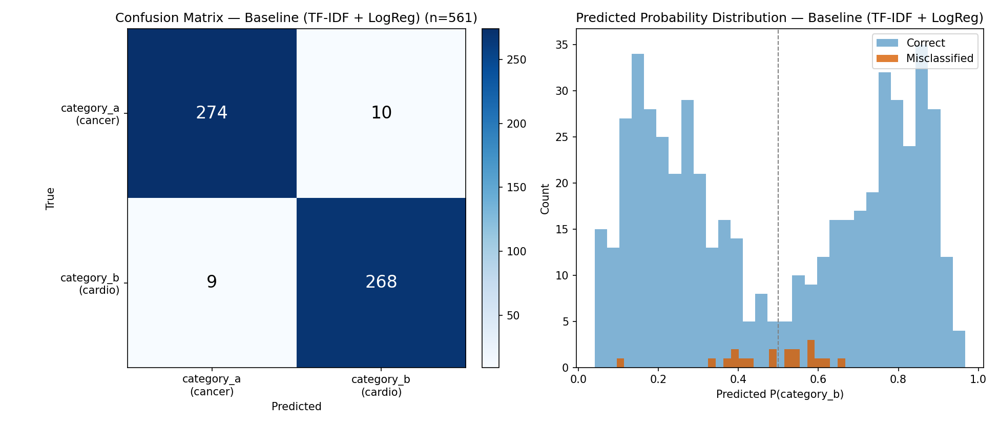
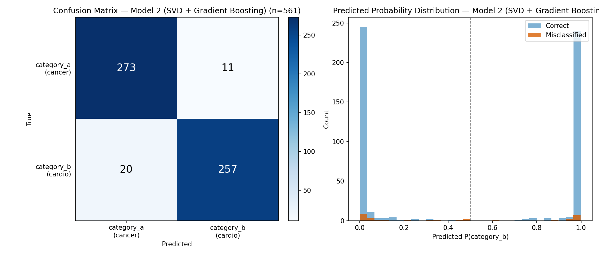
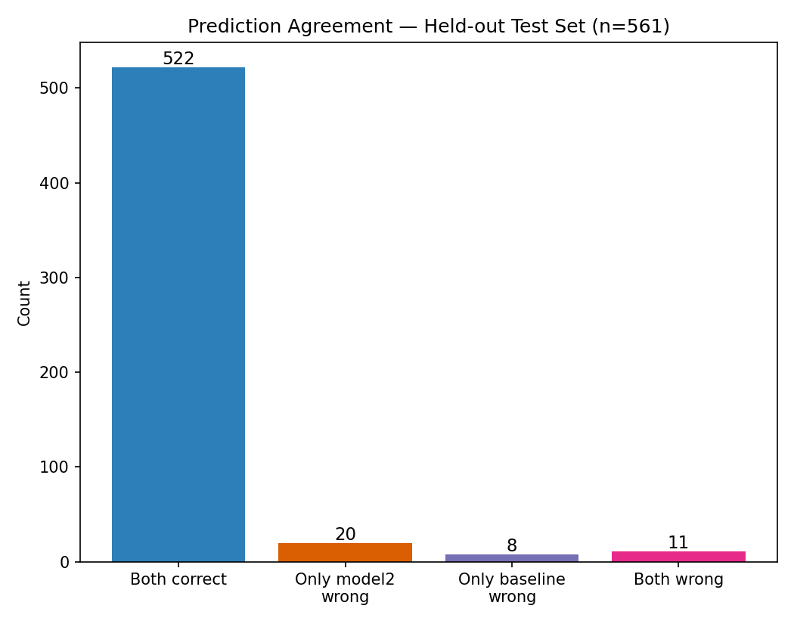

# PubMed Abstract Classification: Neoplasms vs. Cardiovascular Diseases

A small, end-to-end text-classification project with the emphasis on **evaluation rigor** rather than leaderboard chasing: cleaning decisions are documented, performance is reported with confidence intervals, and four models of increasing complexity (linear, tree ensemble, neural network, transformer embeddings) are compared to a simple baseline with paired significance tests and a multiple-comparisons correction.

**Task:** given the title and abstract of a PubMed paper, predict whether it belongs to the *Neoplasms* or *Cardiovascular Diseases* MeSH category (binary classification).

## Headline results

| | Baseline | SVD + GradBoost | MLP (TensorFlow) | Frozen BiomedBERT |
|---|---|---|---|---|
| Pipeline | TF-IDF → Logistic Regression | TF-IDF → TruncatedSVD (200) → Gradient Boosting | TF-IDF → Dense(256) → Dropout → Sigmoid | BiomedBERT embedding (frozen) → Logistic Regression |
| Fitted parameters (approx.) | 20 thousand | 4.0 million (SVD) + 100 boosted trees | 5.1 million | 769 (the 110M-parameter encoder is frozen) |
| CV accuracy (5-fold, train set) | 96.4% (95% CI 94.8–97.9) | 93.8% (92.9–94.8) | **96.5%** (95.7–97.2) | 94.8% (93.8–95.8) |
| CV ROC-AUC | 0.992 | 0.986 | 0.992 | 0.983 |
| Held-out test accuracy (n=577) | 95.3% (Wilson 95% CI 93.3–96.8) | 93.4% (91.1–95.2) | **96.0%** (94.1–97.3) | 93.9% (91.7–95.6) |
| Held-out test errors | 27 | 38 | 23 | 35 |

**Paired comparisons against the baseline** (Holm-corrected across the three challengers):

| Model | CV accuracy difference (paired t-test) | Test set: baseline-only right vs. model-only right (McNemar) |
|---|---|---|
| SVD + GradBoost | **−2.5 pts** (95% CI −3.7 to −1.3), worse on 5/5 folds, p = 0.004, Holm p = 0.013 | 17 vs. 6, p = 0.035, Holm p = 0.10 |
| MLP (TensorFlow) | +0.1 pts (−1.0 to +1.3), better on 2/5 folds, p = 0.77 | 5 vs. 9, p = 0.42, Holm p = 0.43 |
| Frozen BiomedBERT | −1.6 pts (−3.2 to +0.1), worse on 4/5 folds, p = 0.059, Holm p = 0.12 | 20 vs. 12, p = 0.22, Holm p = 0.43 |

- **Nothing reliably beats the baseline.** The MLP is statistically indistinguishable from logistic regression on both tests, despite having ~250× more parameters.
- **SVD + gradient boosting is reliably worse** in cross-validation (it loses on every fold). Its test-set deficit is suggestive but does not survive the multiple-comparisons correction.
- **Frozen BiomedBERT leans worse but is inconclusive** (the CV interval just reaches zero). Using a 110M-parameter encoder only as a fixed feature extractor did not beat TF-IDF on this task.
- **Where the models do differ is probability quality, not accuracy.** The MLP has the best Brier score and log loss (0.034 / 0.119, vs. 0.072 / 0.284 for the baseline), so if predicted probabilities matter, it is the better choice; if only labels matter, the simpler baseline is as good. See [Error analysis](#error-analysis).

## Approach

### 1. Data and cleaning (`src/00_fetch_pubmed_abstracts.py`, `src/01_clean_and_load.py`)
Raw pull: 3000 abstracts from NCBI E-utilities (columns: `pmid, title, abstract, journal, year, label`), loaded into SQLite via pandas. Issues found and how each was handled:

| Issue | Handling |
|---|---|
| PMIDs that appear under **both** categories (e.g. cardio-oncology papers), so the label is genuinely ambiguous | Dropped (72 rows / 36 PMIDs). A deliberate modeling decision; treating them as multi-label is a possible extension |
| Truncated/corrupted abstracts (< 100 chars) | Dropped (0)|
| Missing titles / years | Kept as NULL (not used as features): 17 titles, 1 years |
| Unexpected or missing labels | The script stops with an assertion instead of silently coding them as class 0 |

Result: 2928 abstracts, nearly balanced (1464 Neoplasms / 1464 Cardiovascular).

**Parsing bug found and fixed.** An earlier version of the fetch script read PubMed's XML with `element.text`, which silently drops everything after the first inline tag (`<i>`, `<sub>`, `<sup>`). About 9% of abstracts in that first pull showed signs of mid-sentence truncation (they did not end in terminal punctuation), and only 22 of those were short enough for the < 100-char filter to catch. The script now uses `itertext()`, and every result in this README comes from the re-pulled data. 

### 2. Evaluation protocol
- Stratified 80/20 split; the 20% test set (n=577) is untouched until the final check.
- Stratified 5-fold CV on the training set, reporting mean ± 95% t-based CI per metric.
- **Same split and fold assignment for every model**, so comparisons are paired. `04_compare_models.py` asserts that all models were scored on the identical test rows.
- Accuracy is the primary metric: classes are balanced and neither error type is costlier. F1, ROC-AUC, Brier score and log loss are reported alongside.
- Hyperparameters are library defaults or were fixed in advance; none were tuned on CV or test results. The MLP's early stopping uses a validation slice carved out of each training fold, never the CV validation fold or the test set.

### 3. Models
- **Baseline** (`src/02_baseline_model.py`): TF-IDF over unigrams + bigrams (20k features, English stop words removed) → L2 logistic regression.
- **SVD + GradBoost** (`src/03_train_model2.py`): the same TF-IDF → TruncatedSVD to 200 dense components (LSA) → `HistGradientBoostingClassifier`. A structurally different approach (dense embedding + nonlinear trees) using only scikit-learn.
- **MLP** (`src/07_train_mlp_tensorflow.py`, TensorFlow/Keras): the same TF-IDF features → Dense(256, ReLU) → Dropout(0.5) → sigmoid; Adam, early stopping. Isolates the effect of a nonlinear, gradient-trained classifier on identical inputs.
- **Frozen BiomedBERT** (`src/08_extract_bert_embeddings.py`, `src/09_train_bert_head.py`, PyTorch + Hugging Face): `microsoft/BiomedNLP-BiomedBERT-base-uncased-abstract-fulltext` used as a fixed feature extractor (mean-pooled final layer, max 512 tokens, no fine-tuning) → standardize → logistic regression. Embeddings are computed once and cached; the encoder never sees labels, so embedding the test set leaks nothing.

### 4. Model comparison (`src/04_compare_models.py`)
Two paired tests, because they answer different questions:
- **Paired t-test** on matched per-fold CV accuracies: is the typical gap across resamples distinguishable from zero?
- **McNemar's test** on held-out predictions (exact binomial when discordant pairs < 25): among examples where two models disagree, does one win more than chance?

Each challenger is compared to the baseline, and p-values are **Holm-corrected** across the three comparisons: with three challengers, uncorrected p < 0.05 would give roughly a 14% chance of at least one false "significant" result even if no model differed.

### 5. Robustness to random seed (`src/06_seed_robustness.py`)
The baseline vs. SVD + GradBoost CV comparison was repeated under 5 seeds (the seed controls the split, the folds and model randomness):

SVD + GradBoost is worse on average in 5/5 seeds; significant at alpha=0.05 in 5/5

## Error analysis





Figures show the baseline and SVD + GradBoost (`src/05_error_analysis.py`); the table and agreement counts below cover all four models (`src/04_compare_models.py`).

| Model | Errors | Mean confidence on errors | Errors made with ≥ 90% confidence | Brier | Log loss |
|---|---|---|---|---|---|
| Baseline | 27 | 0.59 | 0 / 27 | 0.072 | 0.284 |
| SVD + GradBoost | 38 | 0.80 | 19 / 38 | 0.051 | 0.192 |
| MLP | 23 | 0.78 | 7 / 23 | 0.034 | 0.119 |
| Frozen BiomedBERT | 35 | 0.88 | 22 / 35 | 0.050 | 0.275 |

- **The baseline is uncertain when it is wrong**: none of its 27 errors were made with ≥ 90% confidence, and its errors sit near the decision boundary. But it is also the least sharp model overall (worst Brier score and log loss), because logistic regression on TF-IDF is under-confident on its correct predictions too.
- **SVD + GradBoost and frozen BiomedBERT are often confidently wrong**: at least half of their errors (19/38 and 22/35) come with ≥ 90% confidence. The MLP has the best probability quality of the four.
- **Agreement:** 516 of 577 test examples (89.4%) are classified correctly by all four models; **11 (1.9%) are missed by all four**, and 29 are missed by exactly one model.
- **The 11 universal misses look mostly like label noise or genuine overlap, not model weakness.** By manual reading (not clinician-verified, and not checked against the MeSH records): several have content that doesn't obviously belong to their assigned category (a Turner syndrome case report and a glutamine-metabolism review labeled Cardiovascular; an arachnoid-web case report labeled Neoplasms), two are multiple-myeloma papers labeled Cardiovascular, and a few sit at real overlaps (a review of cancer-associated thrombosis, a hemangioma, i.e. vascular-tumor, case series). This sets a floor of roughly 2% error that no model here gets under.
- **Non-English text:** 8 of the 577 test texts contain Chinese/Japanese/Korean characters, and each model misclassifies between 2 and 4 of them (a 25–50% error rate vs. 4–7% overall; small numbers, so only suggestive). A language filter is a cheap improvement.

## Caveats
- **The task is lexically easy.** Neoplasm and cardiovascular vocabularies barely overlap, so ~95% accuracy is expected and leaves little headroom. With n=577, a test accuracy is only known to about ±1.7 points (95% interval), so test-set differences of 1–2 points are within noise. The value here is in the evaluation, not the score.
- **CV folds share training data**, so they are not fully independent; the t-test intervals and p-values are somewhat optimistic. With only 5 folds the p-values are also noisy (see the seed analysis), and the frozen-BERT result (p = 0.059) is borderline.
- **Uncertainty is within-dataset only.** CV quantifies variation from resampling this fixed dataset, not from drawing a fresh sample of PubMed abstracts. Generalization to a new pull is plausible but untested.
- **Neural models were trained from a single seed.** Run-to-run variation of the MLP was not measured, so the MLP's small edge or tie with the baseline should not be over-read.
- **"Frozen" BERT is not fine-tuned.** A fine-tuned biomedical model could do better; this result only shows that frozen mean-pooled embeddings plus a linear head do not beat TF-IDF here. Texts longer than 512 tokens are truncated.
- **Labels come from MeSH indexing, which is noisy** (see the universally missed examples), and some abstracts are non-English.
- Results are not directly comparable to earlier runs of this project: the underlying data was re-pulled, which changed both the set of papers and (after the parsing fix) the text quality, so any improvement over earlier numbers cannot be attributed to the fix alone.

## Reproducing

The PyTorch and TensorFlow steps use separate environments, since the two libraries can conflict when installed together. Each extras file includes the base requirements, so either environment can run the scikit-learn-only scripts.

```bash
# Base environment (scripts 00-06)
python -m venv .venv && source .venv/bin/activate
pip install -r requirements.txt

# NCBI asks everyone using its API to identify themselves with a contact email.
# Copy the template, then edit .env and put your own address in NCBI_EMAIL
# (.env is git-ignored, so your address is never committed):
cp .env.example .env

python src/00_fetch_pubmed_abstracts.py   # -> data/raw/pubmed_abstracts.csv
python src/01_clean_and_load.py           # -> data/processed/pubmed.db
python src/02_baseline_model.py           # -> results/baseline_*.csv, models/baseline_pipeline.joblib
python src/03_train_model2.py             # -> results/model2_*.csv

# TensorFlow environment
python -m venv .venv-tf && source .venv-tf/bin/activate
pip install -r requirements-tf.txt
python src/07_train_mlp_tensorflow.py     # -> results/mlp_*.csv
deactivate

# PyTorch environment (08 is slow on a CPU: tens of minutes; it resumes if interrupted)
python -m venv .venv-torch && source .venv-torch/bin/activate
pip install -r requirements-bert.txt
python src/08_extract_bert_embeddings.py  # -> data/processed/bert_embeddings.npz
python src/09_train_bert_head.py          # -> results/bert_*.csv

# Any environment, once the model results exist
python src/04_compare_models.py           # paired tests, Holm correction, error profile
python src/05_error_analysis.py           # -> results/figures/*.png
python src/06_seed_robustness.py          # -> results/seed_robustness.csv
```

The raw CSV has the columns `pmid, title, abstract, journal, year, label`, where `category_a` = Neoplasms and `category_b` = Cardiovascular Diseases. If you already have it, place it at `data/raw/pubmed_abstracts.csv` and skip step 00.

Scripts 01-09 use fixed seeds and are deterministic on the same CSV (up to floating-point differences across hardware for the neural models), so rerunning them reproduces the numbers above. Script 00 queries NCBI live, so a fresh pull will not return exactly the same papers and the numbers will shift slightly.

## Repository layout

```
├── README.md
├── requirements.txt, requirements-tf.txt, requirements-bert.txt
├── .env.example     template for the NCBI contact email (copy to .env, which is git-ignored)
├── data/            raw/ and processed/ are git-ignored (see note below)
├── models/          fitted models (git-ignored)
├── results/
│   ├── *_cv_scores.csv, seed_robustness.csv, missed_by_all_models.csv
│   ├── *_test_predictions.csv   (git-ignored: contain abstract text)
│   └── figures/
└── src/
    ├── config.py    shared paths and constants
    └── 00_… to 09_… scripts (run order above)
```

**Data note:** the raw abstracts are not committed. PubMed abstract text is owned by publishers and distributed under NLM's terms, so the repo ships code and derived statistics only. `src/00_fetch_pubmed_abstracts.py` re-pulls the data from NCBI's E-utilities API (up to 1,500 abstracts per MeSH category). Your contact email is read from the `NCBI_EMAIL` variable in a local `.env` file and is never committed; an optional `NCBI_API_KEY` in the same file raises NCBI's rate limit.

*Author: Anastasia Fokina*
